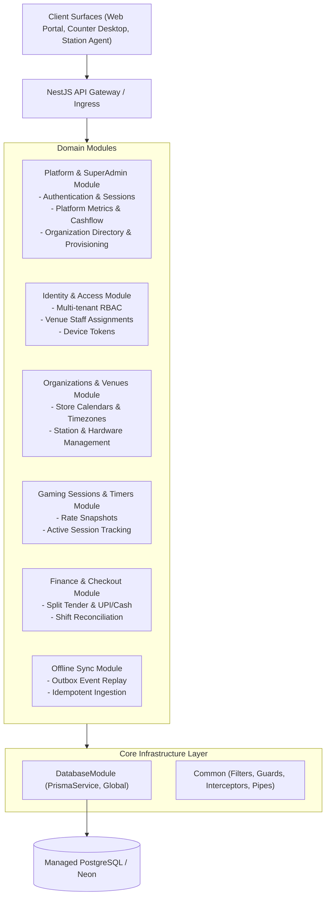

# Haberry Arcade / Hub — Backend Architecture

## Overview

Haberry Arcade backend is structured as an enterprise-grade **Modular Monolith** built on **NestJS** and **Prisma ORM** with **PostgreSQL**. This architecture provides domain boundaries, high cohesion, low coupling, and an incremental migration path to microservices if scale requires it.

## Architectural Principles

1. **Domain Isolation**:
   - Each business capability lives in its own NestJS module (`src/modules/*` or `src/database/`).
   - Modules communicate via exported services or typed events rather than directly accessing another module's database tables.

2. **Global Database Layer**:
   - `PrismaService` lives in `src/database/` and is exported via `@Global() DatabaseModule`.
   - Manages connection pooling, lifecycle hooks (`onModuleInit`, `onModuleDestroy`), and transactional consistency.

3. **Multi-Tenancy & Scoped Permissions**:
   - Tenant boundary is the `Organization`.
   - Operational boundary is the `Location` / `Venue`.
   - Super admin has cross-tenant platform visibility with strict auditing.

4. **Security & Session Management**:
   - `SuperAdminService` hashes credentials using `scrypt` with a cryptographically secure 16-byte salt and 64-byte key length.
   - Authentication tokens are 256-bit entropy (`randomBytes(32)`), stored as SHA-256 digests in `platform_sessions`.
   - Rate limiting protects against brute force attacks (windowed IP/account throttling).
   - Strict `httpOnly`, `sameSite: "strict"`, and secure cookie delivery in browser clients.

5. **Financial & Offline Safety**:
   - Money stored as integer minor units (e.g. cents/paise) with explicit ISO currency.
   - Local counters utilize an SQLite outbox with ordered sequence numbers and idempotent server ingestion.
