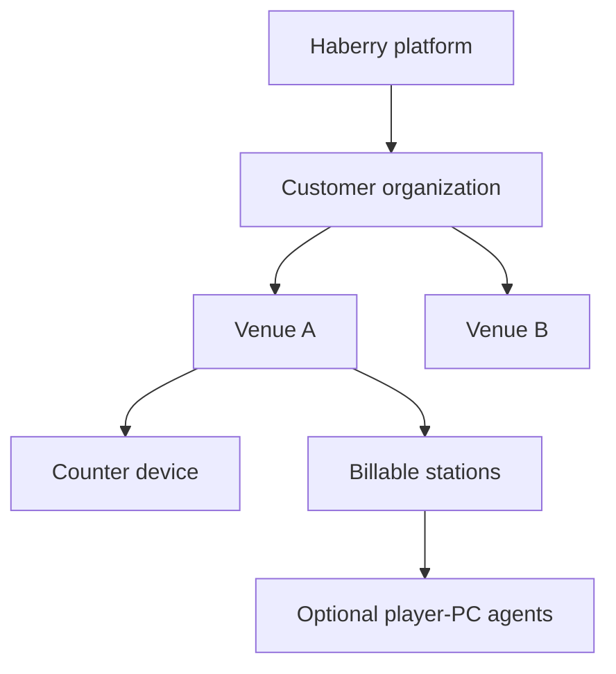

# Haberry Arcade implementation and architecture plan

Haberry Arcade is a SaaS platform for operating local gaming centers. A customer organization can run several venues. Haberry staff manage onboarded organizations from a platform portal, owners manage their portfolio, and venue admins and cashiers run individual locations. A public website markets the product and distributes the signed Windows software.

**Working name** Haberry Arcade. **Pilot assumptions** Staffed Indian gaming venues, INR and venue-local business dates, one active counter writer per venue, and venue staff recording payments they collect. The schema supports multiple locations and owners from the first release. Automatic game launching and workstation controls follow the counter pilot unless they are required to sign a pilot venue.

## 1. Product surfaces

| Surface | Audience | Main responsibility |
| --- | --- | --- |
| Public website | Prospects and clients | Product pages, demo enquiries, sign-in, Windows downloads, release notes and setup guide |
| Platform portal | Haberry staff | Onboard and manage organizations, venues, subscription access, active sessions, device health, payment summaries and support |
| Owner workspace | Venue owners | Manage locations, invite staff, compare locations, inspect sales and payments, configure defaults and review billing |
| Venue workspace | Location admins and cashiers | Manage stations, assigned devices, games, rates, sessions, shifts, payments and local reports according to role |
| Windows Counter | Venue staff | Run shifts, operate the station board, time sessions, collect and record tenders, print receipts and continue through internet outages |
| Windows Station Agent | Managed gaming PCs | Report assigned PC status, apply approved game configuration, and execute supported station controls after the agent phase ships |

Start with one Next.js project for the browser surfaces. Use separate route layouts and service permissions. Keep the public download page inside the main website with its own stable URL.

## 2. Account hierarchy and data access

The customer organization is the tenant and subscription boundary. A person may belong to multiple organizations. Within an organization, an owner has access to every location, while venue roles are granted per location. Staff with assignments at several venues see only those venues. A station represents a billable seat or console. A device represents a paired installation and may be linked to a station or identified as a counter.

| Capability | Platform super admin | Organization owner | Venue admin | Cashier |
| --- | --- | --- | --- | --- |
| Organization lifecycle and subscription | All organizations | View own subscription | — | — |
| Create locations and assign venue admins | All with audit | Own organization | — | — |
| Station, device, game and rate configuration | Inspect all, manage through audited support workflow | All own venues | Assigned venues | View working configuration |
| Sessions, sales, payments and reports | Inspect any organization and location | All own venues | Assigned venues | Operate own shift within venue scope |
| Refunds and voids | Read and audit | Approve own venues | Approve assigned venues with reason | Request |
| Platform staff, releases and support audit | Authorized platform roles | — | — | — |

Use separate platform identities or platform role assignments with mandatory MFA, scoped permissions and audited access. Platform operations can see the full hierarchy and drill into individual operational records, including sessions, receipts, payment methods and references where relevant. Restrict sensitive fields and raw exports to separate permissions, record access to detailed customer records, and require a reason and fresh authentication for high-impact actions. A support operator role can be added with reduced visibility. Staff should never see passwords, signing secrets or card credentials.

## 3. Frontend flow

| Routes | Pages and navigation |
| --- | --- |
| `/`, `/features`, `/demo`, `/downloads`, `/sign-in` | Product overview, enquiry form, Windows Counter installer, published version, supported OS, setup instructions and agent access when released |
| `/super-admin` | Organization counts by lifecycle, enabled and paused subscriptions, venues running sessions, stale counters, unresolved sync issues and recent onboarding |
| `/super-admin/organizations/[orgId]` | Summary, owner and invited staff, venues, subscription and entitlements, payment reports, devices, support history and audit. Selecting a venue opens its live operations and records |
| `/super-admin/releases` | Release channel status, published version, eligible devices, deployment progress and channel pause controls |
| `/app/[orgSlug]` | Portfolio totals and location comparison, organization users and roles, billing, organization game catalog, default rates and organization settings |
| `/app/[orgSlug]/locations/[locationId]` | Station board, paired devices, venue game catalog, sessions, rates, payments, shifts, reports and settings |

Use the organization and venue selectors to preserve scope during navigation. Scoped links must still pass API authorization. Venue-only staff land on their assigned venue or a venue selector. Platform staff enter their own layout after authentication. Shared components include a date and venue filter, searchable tables, timeline, status badges, payment breakdown, and CSV export controls. Provide loading, empty, offline or stale, and denied states. Owner reports should work on mobile, while station setup and platform management can prioritize desktop layouts.

### What “active” means

| Metric | Source |
| --- | --- |
| Active organization | Organization lifecycle is enabled and its entitlement allows usage, including trials if reported separately |
| Active venue | Venue is enabled. Show open shift and in-progress sessions as separate operating indicators |
| Active session | Session has started and has no recorded end event |
| Connected device | Heartbeat received within the configured window. Start with 30-second heartbeats and a 90-second stale threshold, then tune at pilot |
| Current venue data | Counter snapshot and last accepted sync time. Display a stale warning when recent offline operations may be missing |

### Onboarding and everyday use

1. Haberry staff provision an organization, choose a trial or plan, invite the first owner, and optionally add the first location. Record who performed each action.
2. The owner accepts the invitation, opens the organization workspace, creates locations, and assigns venue admins. Each venue gets its timezone, schedule, currency, and business-day cutoff.
3. A venue admin configures billable stations, rates, and enabled games, then creates an expiring pairing code for the correct device type. Windows Counter downloads from the website and pairs online.
4. A cashier opens a shift, starts a session, checks out the player, records cash, UPI or card tender, issues a receipt and counts the till. The owner reviews results across locations. Platform staff can inspect the same records and sync status from their portal.
5. When a venue is suspended, block new sessions once the entitlement change reaches its counter and allow permitted settlement and sync of existing records. Define a bounded offline grace window and retain owner access for historical reports and export where policy permits. Separate suspension from archival.

## 4. Backend architecture

Keep the existing `backend/` NestJS app as a modular monolith and the existing `frontend/` Next.js app. Add `desktop/` for Electron, `packages/contracts/` when shared API types have two consumers, and `infra/` for container and deployment configuration when implementation starts. Add a `station-agent/` project when managed player-PC controls are scheduled.

| NestJS module | Responsibility |
| --- | --- |
| Identity and access | Login, invitations, browser sessions, MFA for privileged roles, organization memberships, venue assignments |
| Platform and provisioning | Customer directory, onboarding, lifecycle, support actions, platform read models and audit |
| Organizations and venues | Tenant profile, locations, business calendars, settings and defaults |
| Devices and catalog | Device enrollment, heartbeat, station assignment, game catalog, venue availability and approved PC game bindings |
| Sessions and pricing | Session lifecycle, timer events, rate versions, immutable charge snapshots |
| Checkout and shifts | Sales, split tender, partial payments, receipts, refunds, cash movements and reconciliation |
| Device sync | Config revisions, accepted events, idempotency, rejection reasons and replay |
| Reporting | Sales and payment ledgers, venue rollups, operational overview and exports |
| SaaS billing and releases | Subscription entitlements, optional billing provider integration, release metadata and supported client versions |
| Jobs and audit | Durable background tasks, export generation, notifications, and operational and financial audit events |

Use versioned REST with OpenAPI. Browser sessions use secure HTTP-only cookies and CSRF protection for mutations. Devices use separate scoped, revocable credentials. Serve web and API through the same public origin where practical. Derive access scope from session, membership, venue assignment, or device enrollment on every request. Define explicit cross-tenant platform endpoints with separate authorization and audit. Use cursor pagination for transaction and audit lists, stable error codes, request IDs and idempotency keys for retryable financial writes. Document conflicts and whether retry is safe. Publish supported desktop protocol versions independently of installer versions.

| Example endpoint | Behavior |
| --- | --- |
| `GET /v1/super-admin/organizations` | Search onboarded clients and filter by lifecycle, subscription and operational health |
| `GET /v1/super-admin/organizations/:orgId/overview` | Organization, venue, subscription, activity and sync summaries |
| `GET /v1/organizations/:orgId/locations` | List locations authorized for the signed-in user |
| `POST /v1/locations/:id/device-enrollments` | Create a short-lived one-time pairing code |
| `POST /v1/devices/pair` | Redeem enrollment and issue scoped device credentials |
| `POST /v1/devices/sync` | Accept ordered events and return per-event outcomes and current configuration revision |
| `GET /v1/locations/:id/reports/payments` | Filter by venue-local business date and tender with freshness metadata |
| `POST /v1/sales/:id/refunds` | Manager-approved idempotent refund record linked to original tender |

## 5. Database decision

**Use managed PostgreSQL for cloud production and SQLite on each Windows counter.** PostgreSQL fits organizations, locations, staff assignments, sessions and payment records because those entities need relational constraints, transactional writes and aggregate reporting. SQLite lets the counter persist local operations and its sync outbox without a separate database server. Begin with one PostgreSQL database and a shared schema. Prisma is a proposed ORM. Keep partial indexes, row security policies, and other database-specific constraints in reviewed SQL migrations.

| Records | Constraints and access |
| --- | --- |
| `users`, `platform_roles`, `organizations`, `memberships`, `location_assignments`, `locations` | Unique membership per organization and person, location assignments scoped to that tenant |
| `stations`, `devices`, `enrollments`, `games`, `location_games`, `station_game_bindings` | Single assignment per active agent and station, unique station name per venue, explicit game availability per venue or station |
| `rate_versions`, `shifts`, `sessions`, `sales`, `sale_lines` | One active session per station and one open shift per counter, with one active counter writer per pilot venue. Preserve rate snapshot and finalized charge |
| `payments`, `refunds`, `cash_movements`, `receipts` | Stable IDs, unique receipt reference, original tender reference for refunds, transactional settlement and concurrent refund caps |
| `sync_events`, `audit_events`, `subscriptions`, `entitlements`, `releases` | Unique event ID per device, ordered acknowledgements, audited privileged actions, separate customer-payment and Haberry-billing records |

Carry `organization_id` on tenant records and `location_id` on venue records. Use composite foreign keys for tenant-owned relationships so records cannot reference another tenant by accident. Index scoped reads by organization, location, timestamp and status where appropriate. Use PostgreSQL row-level security as defense in depth for tenant tables. Set scope inside each database transaction using a non-owner application role without bypass rights, keep migration credentials separate, and use narrowly scoped audited access for platform queries. Test missing context and pooled connection reuse. [PostgreSQL row security documentation](https://www.postgresql.org/docs/current/ddl-rowsecurity.html)

Store money in integer minor units with explicit currency and timestamps in UTC. Capture the venue business date using a versioned cutoff rule. Report gross sales, refunds, net sales, collections by tender, unpaid amounts and shift variance independently. Preserve posted financial history with compensating records and approvals. Keep gaming center customer payments separate from venue subscriptions to Haberry. If a gateway is added, maintain pending and verified states and reconcile confirmed provider events before reporting a payment as verified.

Run PostgreSQL migrations once per deployment. Use backward-compatible schema changes first, then remove obsolete fields after all supported clients stop depending on them. Enable managed backups and point-in-time recovery where available. Suggested pilot targets are 15 minutes maximum cloud data loss and four hours to restore service, subject to a measured restore drill and separate recovery procedures for unsynced counter data.

## 6. Windows Counter implementation

1. **Create `desktop/` with Electron, Electron Forge, React and TypeScript.** Build the station board, shift and checkout UI as a bundled renderer. Keep SQLite, API requests, file handling, receipts, update logic and credential storage in the main process. Use a small typed preload bridge with validated arguments, context isolation, sandboxing and disabled renderer Node integration. [Electron security guide](https://www.electronjs.org/docs/latest/tutorial/security)
2. **Pair and initialize.** Venue admin generates a one-use code. The operator enters it on the counter, checks the venue name, and completes enrollment. Store the scoped credential using Windows-protected storage. Cache the effective configuration and an expiring authorization record for staff already verified online.
3. **Build the shift screen and station board.** Add ready, occupied, checkout due, and out-of-service states. Save session timestamps, rate snapshots, receipts, tender records, and shift activity locally. Recover timers after relaunch and surface clock changes for review.
4. **Build checkout and printing.** Record split tenders and partial payments, persist each transaction with its outbox entry, and allow receipt reprint by stable reference. Start with PDF or standard Windows printing and validate thermal printer support against pilot hardware.
5. **Build and distribute from Windows CI.** Package a signed x64 installer and Squirrel.Windows update artifacts through Electron Forge. Test native SQLite dependencies against the Electron build. Publish setup files, update metadata, version, checksum, supported Windows versions and release notes to object storage behind a CDN. Website downloads resolve from a published release record and are independent of pairing permission. [Electron updater documentation](https://www.electronjs.org/docs/latest/api/auto-updater) · [Electron Forge Windows signing options](https://js.electronforge.io/interfaces/_electron_forge_maker_squirrel.InternalOptions.Options.html)
6. **Run staged releases.** Start with a named pilot channel, then publish stable after install and upgrade smoke tests. Defer installation while a shift, checkout or print job is in progress. Preserve queued work through migrations, keep local backups before destructive schema changes, and rehearse recovery with a schema-compatible build. Pause the rollout when crashes or sync rejections exceed the agreed threshold.

### Offline operation and ownership

The active counter owns venue session and tender writes during the pilot. The web portal owns venue configuration, rates, staff, and reporting. A rate change applies to new sessions after the counter receives it. The portal can manage configuration while the counter is offline and shows when the new revision remains unapplied.

Write the local record and outbox event in one SQLite transaction. Each event carries a stable ID, protocol revision, device sequence and relevant entity/version. The server validates tenant, device and station, deduplicates retries, commits records and event receipts together, and returns accepted, retryable or rejected outcomes. Stop replay of dependent events when an earlier event is rejected. Show the blocked operation and provide a manager reconciliation workflow. Restore a counter or replace its writer enrollment only after checking pending work and reconciling the old queue. Bound offline staff and entitlement access by an expiry that survives restart, and keep approvals for refunds and voids online during the pilot.

### Games and player-PC management

Ship catalog management in the pilot. Organization owners can define a game with title and platform, and venue admins enable it and assign availability to selected stations. Console and VR sessions remain billable through the counter. Where automatic PC launching is required, build a separate signed Windows agent. Give each agent one station assignment and an expiring enrollment. The agent reports health and installed bindings, maps approved game IDs to locally configured launch profiles, and returns command status. Store command ID, expiry, actor and outcome. Use a fixed action list and local approval for changes to game launch profiles. Prove launch and session enforcement on actual pilot PCs before committing to workstation lock or game installation features.

## 7. Docker, hosting and delivery

| Environment | Deployment |
| --- | --- |
| Local | Docker Compose with PostgreSQL, a one-shot migration service, NestJS API, Next.js web, and optional worker. Run the Windows Counter natively against local API |
| CI | Lint, typecheck, test, build Linux web/API images and run migrations against an ephemeral PostgreSQL instance. Separate Windows job packages and smoke-tests installer |
| Staging | Production-like HTTPS, test accounts, test release channel, managed database and representative demo venues |
| Production | Managed Linux containers for web/API and optional worker, private managed PostgreSQL, object storage and CDN for Windows releases, TLS ingress, secrets manager and centralized telemetry |

Create multi-stage Dockerfiles for `frontend/` and `backend/`. Build from locked dependencies, ship runtime dependencies and compiled output, use non-root processes, and exclude secrets, local databases and caches from image context. Tag immutable images by commit SHA. Docker Compose should wait for PostgreSQL health before migrations, then start the API after migration succeeds. Keep local volumes and reset instructions explicit. Add liveness and readiness endpoints, and expose only the necessary ports. [Docker Compose startup order](https://docs.docker.com/compose/how-tos/startup-order/)

Deploy database migrations, then API and worker, then web. Keep at least one compatible desktop protocol during rollout, verify checkout and sync smoke tests, and promote the Windows release last. Keep staging and production credentials, databases and release channels separate. Start with one production region close to pilot venues. Use managed containers and the existing relational database for early jobs. Add Redis or a managed queue if measured throughput or worker isolation warrants it.

Track API latency and error rates, login and pairing failures, stale device heartbeat counts, oldest pending sync item, rejected events, cash variances, desktop crashes, release adoption and backup age. Alert on sustained failures and link to an owner and procedure. Keep device diagnostic exports free of secrets. Estimate monthly costs from database and backups, container compute, traffic and installer downloads, monitoring, transactional email, signing and support. Measure these during pilot before setting package prices.

## 8. Delivery roadmap and acceptance

| Milestone | Implementation | Exit check |
| --- | --- | --- |
| 0. Discovery | Verify venue rates, station types, owner portfolio needs, support visibility, receipt and printer needs, and offline duration | Two venue workflows mapped from shift open through reconciliation. Decide whether the agent is a pilot dependency |
| 1. Platform foundation | PostgreSQL, authentication, platform portal, onboarding, owner workspace, location and role management, local Compose and staging | Haberry provisions a client, the owner creates two venues, and each venue admin can access only assigned records |
| 2. Venue operations | Station/device/game management, rate snapshots, Windows Counter, timed sessions, split checkout, receipts and shift close | Operator completes an entire shift and the payment totals match receipts and tender breakdowns |
| 3. Offline and portfolio visibility | SQLite outbox, retries and reconciliation, platform activity and client detail, owner reporting and exports | Counter survives an offline shift and restart. Replaying the same batch twice preserves financial totals. Owners see both locations and stale counters are obvious |
| 4. Public download and pilot | Signed installer, website download and guide, release channels, incident procedures and backups | Clean Windows PC installs and pairs. Interrupted update recovers. Every pilot venue completes a week without lost or unexplained transactions |
| 5. Paid rollout and PC control | Commercial entitlements and billing, paid support, optional agent for approved workstation management | Billing lifecycle and rollback are exercised. Agent functions pass on supported gaming hardware before general availability |

**Critical verification** Seed two unrelated customer organizations and at least two locations under one owner. Exercise all roles and direct API scope checks. Test duplicate enrollment, expired invitations, revoked devices, missed heartbeats, rate changes mid-session, partial checkout, concurrent refunds and business-date boundaries. Reconcile a sample shift across Windows Counter, venue reports, owner portfolio and platform drill-down. Restore a cloud backup into staging and verify data and application compatibility.

**First implementation slice** Build Haberry onboarding → owner creates two locations → venue admin creates one station and pairs the counter → cashier completes one paid session → venue, owner and Haberry inspect the same receipt under their respective permissions. This exercises every operating boundary before expanding reports, offline scenarios or workstation control.
